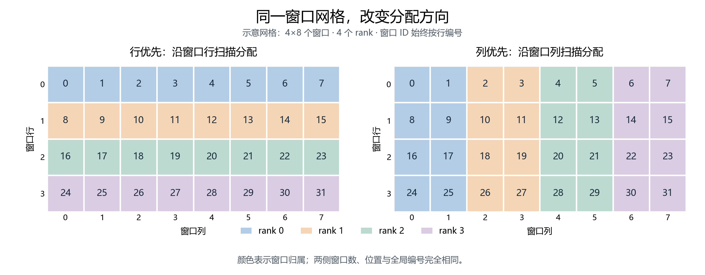
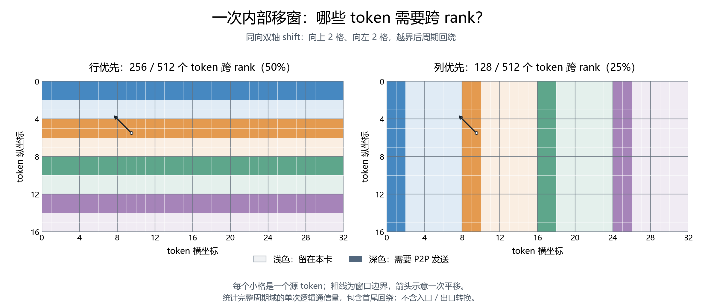

# 实验实现

## 行优先与列优先窗口布局

颜色表示 rank，数字是固定的全局窗口 ID。先看两种布局，再看调用代码。

同样进行双轴半窗 shift，深色 token 需要跨 rank 发送；本例行优先为 256 个，列优先为 128 个。这是逻辑计数，不是硬件性能。

[打开布局与 P2P 调用 demo](terra_next/examples/window_layouts/README.md) · [查看证明](terra_next/docs/window_layouts/README.md)

`terra_next/` 保存 TERRA 当前研发方向的独立实验实现和示例。稳定版入口仍位于仓库根目录。

当前增补包含通用路由运行时快照、布局计划示例和真实四进程 P2P 示例。完整训练、I/O 与 profiling harness 的公开参考模型适配仍需后续增补；本目录不包含生产 Wenhai 模型、数据集、权重或集群配置。
