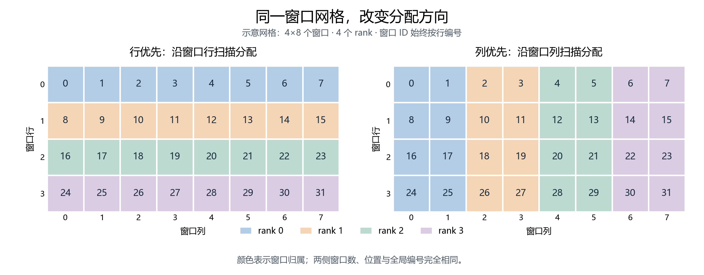
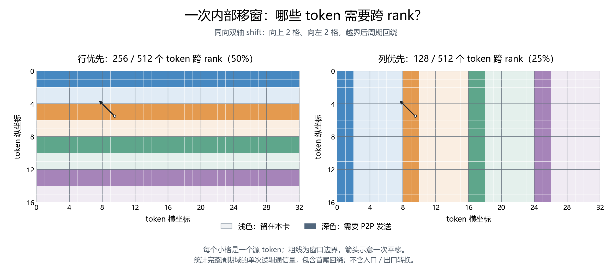

# TERRA next 实验区

这里先用图和可运行代码展示行优先、列优先窗口所有权，再给出精确通信量证明。当前增补包含通用路由基础运行时的 29 文件快照，不是整个研究工作区的完整训练发行版。

## 两种窗口布局

同一张图包含 4×8 个窗口，交给 4 个 rank；颜色表示 owner。每个 rank 均有 8 个窗口，全局窗口 ID 和物理坐标始终不变。



每个窗口再划分为 4×4 个 token，进行双轴半窗 shift。下图深色部分需要 P2P 发送，浅色部分留在本 rank。统计包含周期首尾回绕，不含 stage 入口和出口。



在这个小例中，行优先需要发送 256 个 token，列优先为 128 个。这是逻辑计数示例，不是 GPU/NPU 性能结果，也不意味着所有形状或并行度下列优先都更优。

## 布局与发送计划 demo

仅需 Python 3.8 及以上，无 PyTorch、设备或网络依赖。在仓库根目录执行：

```bash
python -B experimental/terra_next/examples/window_layouts/window_layout_demo.py
```

也可切换到 `examples/window_layouts/` 目录后直接调用：

```python
from window_layout_demo import build_layout, shift_plan

for order in ("row", "column"):
    layout = build_layout(4, 8, 4, order, "paper_floor")
    plan = shift_plan(layout, window_size=4, shift_y=2, shift_x=2)
    print(order, layout.window_ids_by_rank[0], plan.remote_tokens)
```

输出：

```text
row    (0, 1, 2, 3, 4, 5, 6, 7)     256
column (0, 8, 16, 24, 1, 9, 17, 25) 128
```

此 demo 生成 owner、peer 发送矩阵和 token 计数，不执行分布式通信。

## 真实 TokenRoute 调用

下面的完整脚本会启动 4 个真实 CPU/Gloo 进程，使用本目录 `src/` 中的 `DMPMesh`、`TokenLayout`、`TokenRoute`，验证实际 P2P 的前向值和加权反向梯度。需要可用的 PyTorch/Gloo 环境；本地已在 Python 3.12、PyTorch 2.11 CPU 环境验证。

```bash
python -B experimental/terra_next/examples/window_layouts/demo_token_route.py \
  --runtime-root experimental/terra_next/src \
  --output p2p_demo_output
```

核心调用为：

```python
# 每个已初始化的 distributed rank 内执行；mesh 是同一个 WP=4 的 DMPMesh。
from terra.core.FMP.layout import TokenLayout, TokenRoute

plain = TokenLayout(mesh, 16, 32, 4, shift=0,
                    window_assignment="column_contiguous")
shifted = TokenLayout(mesh, 16, 32, 4, shift=2,
                      window_assignment="column_contiguous")
route = TokenRoute(plain, shifted,
                   restore_implementation="inverse_gather",
                   transport_implementation="p2p",
                   window_shift="generic")
y = route(x)  # x.shape == plain.shape(batch, channels)
```

将 `column_contiguous` 改为 `contiguous` 即运行原有行优先分配。该运行时使用 v8 的前缀余数切分；上面的 32 窗口示例可以被 4 整除，因此与 `paper_floor` 一致。不整除时两种切点规则必须分别分析。

这份脚本是路由正确性演示，不运行训练，不提供秒／步或 TFLOP/s，也不替代此前大模型 BF16 的完整数值验证。输出目录需是新目录，避免覆盖已有证据。

## 核验与绘图

```bash
python -B experimental/terra_next/examples/window_layouts/test_window_layout_demo.py
python -B experimental/terra_next/docs/window_layouts/verify_theorem.py --output-dir theorem_checks
```

重新绘图需要 numpy、matplotlib 和中文字体。可设置 `TERRA_PLOT_FONT` 指向本地中文字体文件：

```bash
python -B experimental/terra_next/examples/window_layouts/render_layouts.py --output-dir layout_figures
```

附图、计划 demo、独立逐 token oracle 和实际 P2P 路由已对齐到同一个小例。验证摘要见 `VALIDATION.json`。理论正文与论文 LaTeX 片段放在 `docs/window_layouts/`。

## 当前目录与后续范围

```text
experimental/terra_next/
  src/terra/                 通用路由与所需的运行时、profiling 支持模块
  examples/window_layouts/   计划 demo、真实 P2P demo、绘图脚本与示例测试
  docs/figures/              中文 PNG／SVG
  docs/window_layouts/       证明、LaTeX 与独立验证器
  RUNTIME_MANIFEST.json      29 个运行时源文件的来源哈希
  VALIDATION.json            本增补的验证摘要
```

现有研究训练 harness 仍绑定生产 Wenhai 模型，不能通过改目录名称就成为公开发行版。后续应将模型构造、算子分类及 FLOPs 口径适配公开的 `credit_hierarchical_swin`，再接入训练、I/O 和 profiling 入口。当前 `src/` 未包含模型代码或完整训练 harness。

本增补继承仓库许可证及适用的上游声明，参见 [仓库第三方声明](../../THIRD_PARTY_NOTICES.md)。
