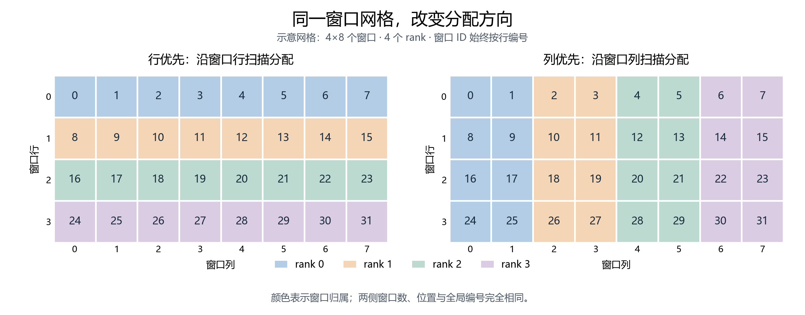
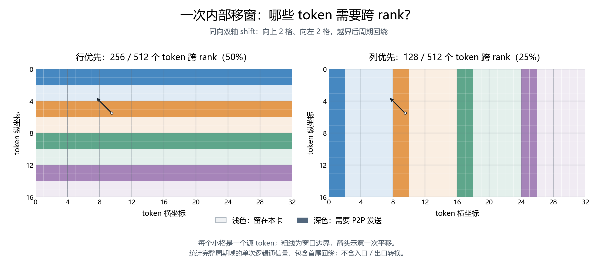

# 窗口布局图与通信量证明

先看同一窗口网格的两种 rank 所有权。窗口数、物理位置和全局 ID 相同。

再看双轴半窗 shift 后哪些源 token 跨 rank。深色为需要发送的区域；本例行优先 256 个、列优先 128 个，包含周期回绕。

[运行布局与真实 P2P demo](../../examples/window_layouts/README.md)

## 阅读顺序

1. [中文完整证明](proof_zh.md)：从窗口分配、邻接计数到有条件的方向定理。
2. [论文 LaTeX 片段](theorem.tex)：同一推导的英文正文。
3. [独立验证脚本](verify_theorem.py)：逐 token、邻接枚举和闭式公式互相核对。

图中的 4×8 窗口小例可整除。证明还覆盖满足假设的 ragged 均分，并明确区分论文 floor 切点与 v8 prefix 切点。通信量更少不自动等于实际耗时更短，也不替代大模型 BF16 数值校验。
