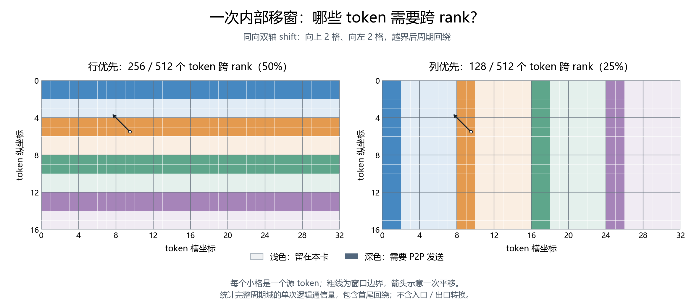

# 均衡连续窗口分配的内部移窗通信量证明

先看两种窗口归属布局，再进入数学证明。颜色表示 rank，数字是固定的全局窗口 ID。

下图深色 token 需要跨 rank 发送，浅色 token 留在本卡。本例为 4×8 个窗口、w=4、P=4 的双轴半窗 shift，行优先 256 个、列优先 128 个；包含周期回绕，不含入口／出口。

[先运行布局与真实 P2P demo](../../examples/window_layouts/README.md)

本节给出行优先与列优先窗口分配的内部 shift 通信量公式，并证明在明确条件下，宽图的列优先通信量严格少于行优先。结论覆盖整除和 ragged 均分，适用于给定完整窗口所有权下的纯 WP 路由。它不包含入口、出口或运行时间的结论。

本次论证整理日期为 **2026 年 11 月 17 日**。本文提供数学结果及可复算口径，不据此声称相关布局或边界通信机制的首次提出。

## 1 模型与共同假设

令完整窗口域为高 $H=Rw$、宽 $W=Cw$ 的二维 token 网格，其中 $R,C$ 是窗口行列数，$w$ 是方形窗口边长。下文的 $C$ 始终表示窗口列数，特征维度另记为 $F$。

1. 使用纯窗口并行 WP：每个完整窗口由一个 rank 持有，窗口内的 $F$ 维特征保持完整；不混入 SP 或 TP。
2. $P$ 个 rank 满足 $2\le P\le\min(R,C)$。
3. 分配规则在窗口数上均衡。令 $N=RC$、$q=\lfloor N/P\rfloor$，每段长度 $n_p\in\{q,q+1\}$，且 $\sum_p n_p=N$。
4. 切点为 $b_0=0$、$b_{p+1}=b_p+n_p$、$b_P=N$。行列两种扫描使用**同一组切点**，均从全局窗口 $(0,0)$ 开始，不任意循环平移扫描起点。
5. 内部 shift 是双轴等幅平移 $(d,d)$，$0<d<w$；坐标按完整域 $Rw\times Cw$ 周期取模。半窗定理另要求 $w$ 为偶数且 $d=w/2$。
6. 完整窗口域中的所有 token 都参与内部路由，包括模型 padding 的演化值。零插入和裁剪属于 stage 边界，不计入本节内部 shift。

全局窗口 ID 固定为行优先编号 $iC+j$，不随所有权扫描改变。设 $g(t)=p$ 当且仅当 $b_p\le t<b_{p+1}$。两种 owner 分别为

$$
G_r(i,j)=g(iC+j),\qquad G_c(i,j)=g(jR+i).
$$

这改变窗口所有权与本地窗口序列，不转置模型的全局物理坐标。

定义不对齐切点数

$$
k_r=\#\{p\in\{1,\ldots,P-1\}:b_p\bmod C\ne0\},
\qquad
k_c=\#\{p\in\{1,\ldots,P-1\}:b_p\bmod R\ne0\}.
$$

显然 $0\le k_r,k_c\le P-1$。它们描述 ragged 边界切入窗口行或列的修正量。

## 2 一次移窗的通用计数恒等式

对任意 owner 网格 $G$，在窗口坐标按模 $R,C$ 取值时，定义有向邻接不匹配数

$$
A_h=\sum_{i,j}[G(i,j)\ne G(i,j-1)],
$$

$$
A_v=\sum_{i,j}[G(i,j)\ne G(i-1,j)],\qquad
A_d=\sum_{i,j}[G(i,j)\ne G(i-1,j-1)].
$$

这里 $[\cdot]$ 为示性函数；计数包含周期首尾边界。

从未 shift 布局转到 shift 为 $d$ 的布局时，源全局 token $(y,x)$ 的目标窗口坐标由 $((y-d)\bmod H,(x-d)\bmod W)$ 决定。一个窗口内的 token 分成四个互不重叠区域：

| 目标窗口相对于源窗口 | token 数 | 是否由 owner 比较决定远端迁移 |
| --- | ---: | --- |
| 原窗口 | $(w-d)^2$ | owner 相同，不发送到远端 |
| 左邻窗口 | $d(w-d)$ | 计入 $A_h$ |
| 上邻窗口 | $d(w-d)$ | 计入 $A_v$ |
| 左上邻窗口 | $d^2$ | 计入 $A_d$ |

因此，一个 batch 样本、一次内部 shift、全 rank 累计的远端 token 行数精确为

$$
\boxed{S=d(w-d)(A_h+A_v)+d^2A_d.}\tag{1}
$$

这里按源 token 的唯一 owner 计一次远端发送，不把接收端再次计入，不包含同 rank 的本地复制。

## 3 行优先的邻接引理

**引理。** 在第 1 节的均衡分配与固定扫描起点条件下，行优先 owner 满足

$$
\boxed{A_h=2k_r,\qquad A_v=PC,\qquad A_d=PC.}\tag{2}
$$

**证明。** 首先，$q=\lfloor RC/P\rfloor\ge C$，所以任意两个相邻切点在循环扫描序列上的距离至少为 $C$。

**水平邻接。** 每个窗口行内部至多包含一个切点。一个位于行内部的切点，使该行的循环水平邻接出现两处 owner 变化：切点处一次，行末回到行首时一次。位于完整行边界的切点不产生水平 owner 变化。故 $A_h=2k_r$。

**竖直邻接。** 在展平的循环序列 $\mathbb Z_N$ 中，上邻映射就是 $t\mapsto t-C$。由于每段长度至少为 $C$，半开循环区间 $(t-C,t]$ 至多跨一个 rank 切点。每个切点恰好对应其后 $C$ 个发生 owner 变化的源位置，故 $A_v=PC$。这里 rank 之间共有 $P$ 个循环边界，其中包括最后一个 rank 回到第一个 rank 的边界；因此系数是 $P$，不是 $P-1$。

**对角邻接。** 需要区分两种情况。

- 若 $P=R$，则 $N/P=C$，所有段长度都等于 $C$。由 $b_0=0$ 可知每个 rank 恰好拥有一个完整窗口行。任一窗口的上邻与左上邻都在另一个 rank，因此 $A_v=A_d=RC=PC$，同时 $k_r=0$。
- 若 $P<R$，利用 $C\ge P$ 得

  $$
  q=\left\lfloor\frac{RC}{P}\right\rfloor
  \ge C+1.
  $$

  先考虑辅助的循环映射 $t\mapsto t-(C+1)$。每段至少长 $C+1$，所以每条长度 $C+1$ 的半开路径至多跨一个切点。每个切点 $b$ 对应 $t=b,b+1,\ldots,b+C$ 共 $C+1$ 个不匹配位置，辅助映射的总不匹配数为 $P(C+1)$。

  真实左上邻在列号非零时正是该辅助映射；在每行首列 $t\bmod C=0$ 时，它应为 $t\mapsto t-1$。考察这项替换对每个切点的影响：

  - 若 $b\bmod C=0$，辅助映射在两个行首位置 $b$ 与 $b+C$ 不匹配。短映射只在 $b$ 不匹配，因此净减少一个。
  - 若 $b\bmod C\ne0$，辅助映射只有一个行首不匹配位置 $C\lceil b/C\rceil$。该位置不是切点，短映射不跨界，因此同样净减少一个。

  相邻切点至少间隔 $C+1$，上述修正不会重复计数。因此总共减少 $P$ 个不匹配位置，得到 $A_d=P(C+1)-P=PC$。

三项均证。$\square$

对列优先把网格转置为 $C\times R$ 应用同一引理，可得

$$
\boxed{A_h=PR,\qquad A_v=2k_c,\qquad A_d=PR.}\tag{3}
$$

转置仅用于证明中的 owner 网格分析，不要求实现实际转置特征张量。

## 4 精确公式与半窗方向定理

将式 (2)、(3) 代入式 (1)，得到等幅 shift $0<d<w$ 的精确公式

$$
\boxed{S_r=PCwd+2d(w-d)k_r,\qquad
S_c=PRwd+2d(w-d)k_c.}\tag{4}
$$

**定理。** 若 $w$ 为偶数、$d=w/2$，且保持第 1 节的共同假设，则

$$
\boxed{S_r=\frac{w^2}{2}(PC+k_r),\qquad
S_c=\frac{w^2}{2}(PR+k_c).}\tag{5}
$$

当 $C>R$ 时，列优先内部 shift 的总远端 token 行数严格更少；当 $R>C$ 时，行优先严格更少；当 $R=C$ 时，两者相等。

**证明。** 半窗条件直接把式 (4) 化为式 (5)。若 $C>R$，则 $C-R\ge1$，所以

$$
S_r-S_c
=\frac{w^2}{2}\bigl[P(C-R)+k_r-k_c\bigr]
\ge\frac{w^2}{2}\bigl[P-(P-1)\bigr]
=\frac{w^2}{2}>0.
$$

高图的结论交换 $R,C$ 即得。正方形中行列两种扫描共享同一组切点，故 $k_r=k_c$，式 (5) 给出相等。$\square$

若两侧均整行／整列对齐，即 $k_r=k_c=0$，还可写成

$$
S_r=PdW,\qquad S_c=PdH,\qquad \frac{S_c}{S_r}=\frac{H}{W}.
$$

它表达了边界长度的几何直觉；式 (5) 则保留不整除所产生的修正，而非假设所有 rank 都是完整矩形条带。

## 5 论文 floor 与当前 prefix 的口径区分

两种切点都满足本节的均衡段长假设，但切点和 $k$ 值可能不同，不能混用。

- TERRA 论文第 V-A 节式 (4) 的 floor 边界：$b_p=\lfloor pN/P\rfloor$。
- 本次 v8 对照实现的 prefix remainder 边界：设 $r=N\bmod P$，则 $b_p=pq+\min(p,r)$。

论文链接：[TERRA 第 V-A 节](https://arxiv.org/html/2608.15211#S5.SS1)。下面是在**同一指定窗口几何**上的整数复算，并非声称论文报告过这些实验计数。

| 窗口网格与窗口边长 | 切点规则 | 内部切点 | $k_r,k_c$ | $S_r$ | $S_c$ |
| --- | --- | --- | --- | ---: | ---: |
| $43\times90$，$w=6$，$P=4$ | v8 prefix | 968，1936，2903 | 3，3 | 6,534 | 3,150 |
| 同上 | 论文 floor | 967，1935，2902 | 3，2 | 6,534 | 3,132 |
| $8\times17$，$w=32$，$P=4$ | 两种规则相同 | 34，68，102 | 0，3 | 34,816 | 17,920 |

第一组对应完整域 $258\times540$，第二组为 $256\times544$。它们包含完整模型 padding，不能把未 padding 的真实尺寸直接代入窗口邻接公式。

## 6 计数、字节与时间的边界

对 batch 大小 $B$、每 token 特征维度 $F$，若每个实际传输标量占 $\beta$ 字节，一次方向的逻辑发送负载为

$$
V=BFS\beta.
$$

$\beta$ 必须由实际 wire dtype 确定，不能从 BF16 AMP 推断。完整内部路由为排列时，反向逆路由具有相同的远端 token 总数；若正反向 wire 宽度不同，二者负载应分别计算为 $BFS\beta_f$ 和 $BFS\beta_b$。

定理不计 stage 入口／出口重分布、卷积 Halo、参数梯度规约、协议包头、路由中继、本地 pack／restore、设备内存访问或通信计算重叠。更少的全局 token 总量也不保证更少的非零 peer 对、更小的最慢 rank 负载或更短的实际时间。它只比较这两种给定 owner 策略，不证明列优先优于所有二维 tile 或其他通信算法。

## 7 不能省略的假设与反例

1. **奇数窗口不能直接套用半窗方向结论。** 取 $R=5,C=6,P=5,w=3,d=1$，两种规则都均衡且从原点开始。式 (4) 给出行优先 $90$、列优先 $91$；图虽更宽，列优先反而多一个 token。一般 shift 公式仍成立，但半窗简化不成立。
2. **$P=1$ 时实际通信为零。** 本节闭式公式的适用范围从 $P=2$ 开始。
3. **不能取消 $P\le\min(R,C)$。** 例如 $R=2,C=3,P=6,w=2,d=1$，每个窗口各占一个 rank，行列仅是 owner 标签排列，两者总远端 token 数都是 $18$，不满足宽图严格不等式。
4. **仅要求每段长不小于 $\max(R,C)$ 仍不足。** 取 $R=C=4,P=3$，未均衡的段长 $[5,4,7]$。行优先有 $(A_h,A_v,A_d)=(4,12,11)$，而不是 $(4,12,12)$。证明必须保留均衡性，或另行加强并证明边界条件。
5. **扫描原点不可任意循环平移。** 当 $R=C=P=2$、每段长 $2$ 时，把行扫描切点整体循环移一格会形成两行交错的 owner，$A_d$ 可变成 $0$。本节规定的 $b_0=0$ 排除了该反例。
6. **双轴等幅 shift 是模型的一部分。** 若只沿一个轴移动，邻接权重改变；例如整行条带上的纯水平 shift 可完全本地，不能沿用双轴半窗结论。
7. **不能通过丢掉内部 padding 偷换计数域。** padding 经 attention、MLP 和残差后可演化；内部完整窗口路由必须保持这些值。

## 8 复核与引用建议

随附 `verify_theorem.py` 使用整数 owner 与独立坐标枚举复核邻接计数、闭式公式、方向不等式、两种切点规则和指定几何。脚本复核所列反例中的奇数窗口、并行度、单轴 shift 和未均衡切点情形；扫描原点反例另有本文的显式构造。实际运行环境、覆盖范围及结果以 `verification.json` 为准。有限枚举提供实现核对，数学证明由第 3、4 节给出。

可采用的贡献表述是：

> 对均衡连续窗口分配建立包含 ragged 切点修正的内部移窗通信量公式，并证明在偶数方窗、双轴半窗 shift 与适中 WP 并行度下，宽图采用列优先可严格减少内部 shift 的总远端 token 数。

论文或公开仓库中应同时保留适用条件、实际切点口径及排除项。将此作为理论分析贡献，不自动等价于所有权布局、边界通信机制或实际加速的优先权声明。配套英文 LaTeX 片段见 `theorem.tex`。