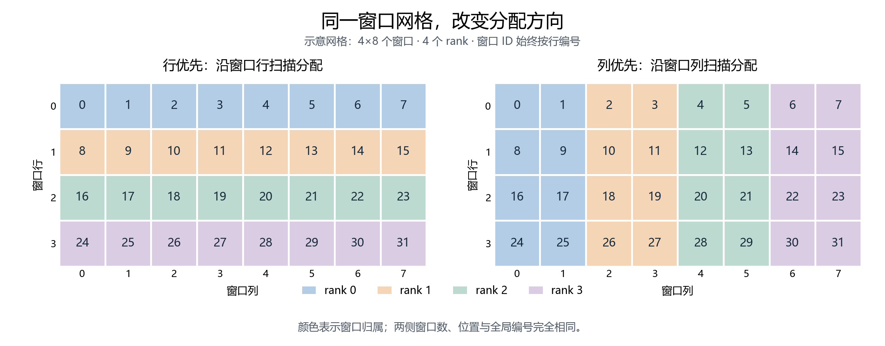
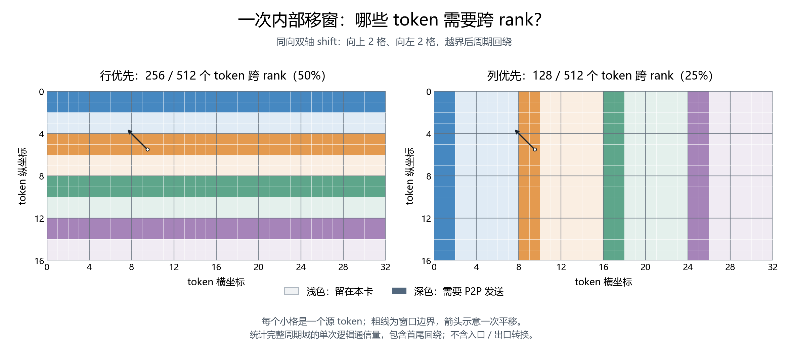

# 行优先与列优先窗口布局 demo

同一张图有 4×8 个窗口、4 个 rank。颜色表示窗口归属，数字始终是行优先编号的全局窗口 ID；改变的是 owner 和本地扫描顺序。



窗口边长为 4，向上、向左各 shift 2 个 token。深色部分要跨 rank 发送，浅色部分留在本卡；包含周期回绕，不含入口和出口。



本例行优先发送 256 个 token，列优先发送 128 个；两侧均为 512 个 token，每个 rank 均持有 8 个窗口。

## 什么时候列优先严格更省通信

**在下列条件下，列优先的内部 shift 总远端 token 数严格少于行优先：**

- 使用纯 WP，完整窗口由单个 rank 持有，保留完整模型 padding 域及周期回绕。
- 窗口网格为 R×C 且 C>R；窗口为偶数边长 w 的方窗，双轴同向 shift 均为 w/2。
- 行列扫描均从固定原点出发，使用相同的均衡连续切点；并行度满足 2≤P≤min(R,C)。

直观上，横向条带的通信边界沿图像宽度展开，纵向条带沿高度展开；宽图的纵向边界更短。完整证明还计入不整除时的 ragged 切点修正，结论不依赖所有 rank 都恰好分到完整矩形条带。

在相同条件下，高图 R>C 时行优先更少，方形网格 R=C 时两者相等。这是**内部通信总量**结论，不包含入口／出口转换，也不保证整步耗时更短或优于所有二维 tile 分配。

[查看完整公式、证明与反例](../../docs/window_layouts/proof_zh.md)

## 直接调用

进入本目录后运行，不需要 PyTorch：

```bash
python -B window_layout_demo.py
```

```python
from window_layout_demo import build_layout, shift_plan

for order in ("row", "column"):
    layout = build_layout(4, 8, 4, order, "paper_floor")
    plan = shift_plan(layout, window_size=4, shift_y=2, shift_x=2)
    print(order, layout.window_ids_by_rank[0], plan.remote_tokens)
```

输出：

```text
row    (0, 1, 2, 3, 4, 5, 6, 7)     256
column (0, 8, 16, 24, 1, 9, 17, 25) 128
```

## 重新画图

仍在本目录执行，需要 numpy、matplotlib 和中文字体：

```bash
python -B render_layouts.py --output-dir ../../docs/figures
```

可通过 `TERRA_PLOT_FONT` 指定中文字体文件。画图和布局计划是两个独立入口；上面的计划命令默认输出 JSON，绘图命令输出 PNG／SVG。

## 实际 P2P 调用

下面启动 4 个真实 CPU/Gloo 进程，调用通用运行时的 `TokenLayout`／`TokenRoute` 并检查前向值与加权反向梯度，需要可用的 PyTorch/Gloo：

```bash
python -B demo_token_route.py --runtime-root ../../src --output p2p_demo_output
```

输出目录需要尚不存在。这是路由正确性示例，不是训练或 GPU/NPU 性能测试。

[完整实验说明](../../README.md) · [通信量证明](../../docs/window_layouts/README.md)
